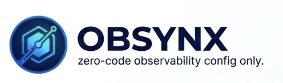
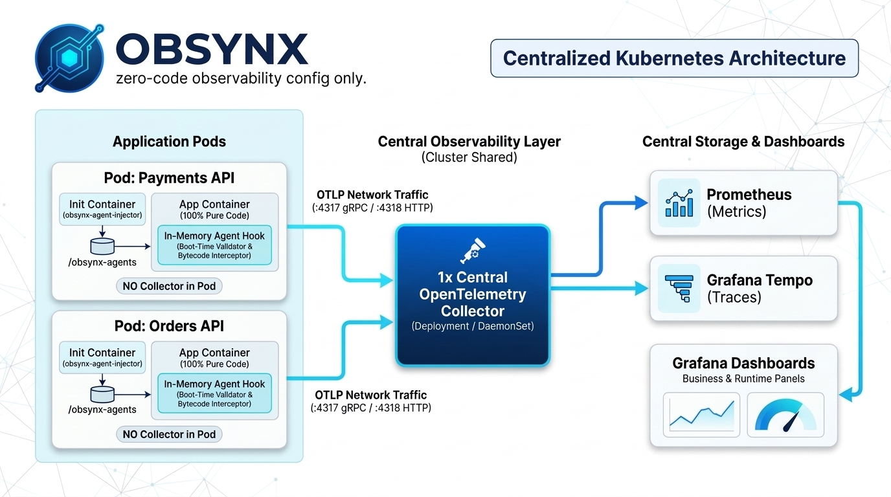
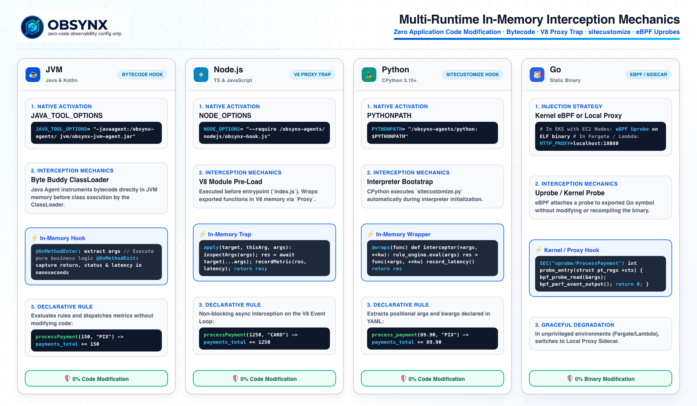
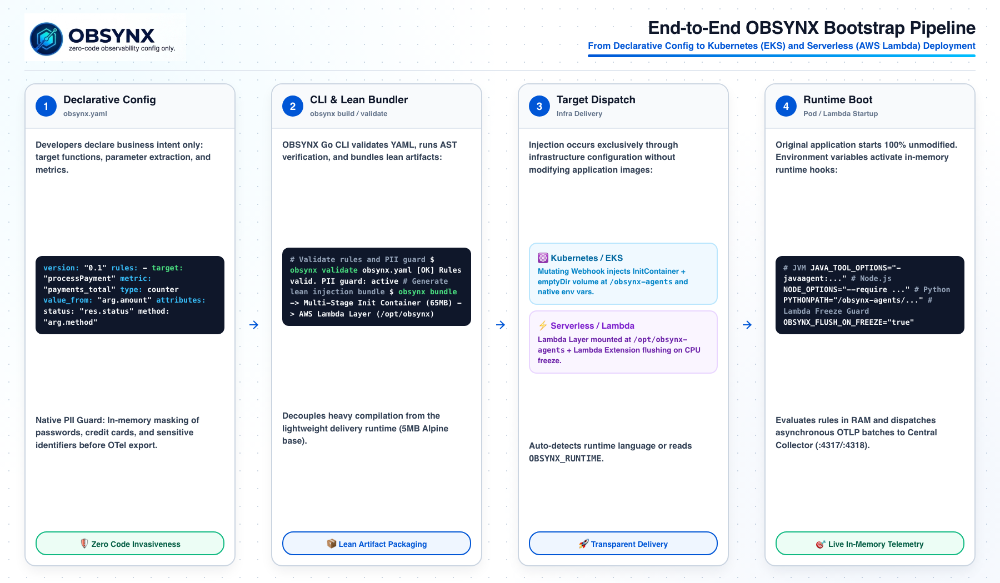

# OBSYNX



> **Zero-Code Observability. Config Only.**  
> Full control, governance, and business metrics extraction on top of OpenTelemetry without altering a single line of application code.


---

## Overview

**OBSYNX** is an observability control plane, automation, and orchestration platform built on top of the **OpenTelemetry** ecosystem. It decouples application source code from telemetry SDKs, allowing engineering teams to declare custom business metrics, method tracing, and observability governance purely via declarative `obsynx.yaml` manifests.

---

## 🚀 Observability GitOps & Enterprise Governance

OBSYNX supports total decoupling between application source code and telemetry rules via the **GitOps Observability** architecture:

* **Architecture Guide:** [GitOps for Observability: Enterprise Architecture & Governance Guide](docs/architecture/gitops-observability-guide.md)
* **Reference Implementation:** [examples/gitops-telemetry-governance/](examples/gitops-telemetry-governance/)
  * `.github/CODEOWNERS` for squad-level segregation.
  * GitHub Actions CI pipeline with schema validation and shift-left PII scanning.
  * Production examples for **Kubernetes**, **AWS EKS** (via `ConfigMap`), and **AWS Lambda** (Serverless Layer).
  * Automatic precedence resolution (`OBSYNX_CONFIG_PATH` vs `/app/obsynx.yaml`).

---

## 🎯 Supported Runtimes & Versions

> **Zero application code modification.** Runtime injection occurs exclusively via infrastructure configuration (`JAVA_TOOL_OPTIONS`, `NODE_OPTIONS`, `PYTHONPATH`, `CORECLR_ENABLE_PROFILING`, `InitContainer`, or `Lambda Layer`).

| Language / Runtime | Supported Versions | Recommended Version | Interception Mechanism | Technical Notes |
| :--- | :--- | :--- | :--- | :--- |
| **☕ JVM (Java / Kotlin)** | **Java 8, 11, 17, 21, 22+** | **Java 17 & 21 (LTS)** | Byte Buddy (`JAVA_TOOL_OPTIONS`) | Transparent support for Java 21+ Virtual Threads. Zero GC impact. |
| **⚡ Node.js (TS / JS)** | **v18.x, v20.x, v22.x+** | **v20.x & v22.x (LTS)** | V8 Proxy Trap (`NODE_OPTIONS`) | Requires ES6 Proxy support. Fully compatible with CommonJS & ESM. |
| **🐍 Python** | **3.9, 3.10, 3.11, 3.12, 3.13** | **3.11 & 3.12** | `sitecustomize.py` (`PYTHONPATH`) | Native CPython bootstrap hook. Supports sync and async (`asyncio`). |
| **🔷 .NET (C# / F#)** | **.NET 6, 7, 8, 9+** | **.NET 8 (LTS)** | CoreCLR Profiler + StartupHook | Zero SDK dependencies in `.csproj`. Injected via `CORECLR_PROFILER`. |
| **🐹 Go** | **Go 1.20, 1.21, 1.22, 1.23+** | **Go 1.21+** | eBPF Uprobes or Local Proxy | Go binary must not strip symbols (`-ldflags="-s -w"`). On Fargate/Lambda, switches to Local Proxy (:18080). |

---

### Core Principles
* **100% Pristine Code & Dockerfiles:** Zero OpenTelemetry SDK imports in `pom.xml`, `build.gradle`, `package.json`, `requirements.txt`, `.csproj`, or `go.mod`.
* **External Runtime Injection:** Official OTel agents and bytecode/runtime hooks are injected at runtime via Init Containers or non-destructive environment overrides.
* **Fail-Fast Boot Validation:** The agent validates business rules and methods before accepting incoming connections. If a declared method or attribute does not exist or contains sensitive PII (passwords, tokens, credit cards), the container immediately halts boot (`Exit 1`).
* **Centralized Shared Architecture:** Telemetry collection, Prometheus, and Grafana run as shared infrastructure services without overloading application pods.

---

## Production Architecture (Kubernetes & EKS)

In production environments, application Pods contain **only application code and the lightweight in-memory agent** (mounted via `obsynx-agent-injector`). The **OpenTelemetry Collector runs centrally** for the entire cluster (Deployment or DaemonSet), dispatching telemetry to Prometheus and Grafana Tempo.



### Architecture Components:
1. **Init Container (`obsynx-agent-injector`):** Runs prior to application startup and copies lightweight runtime hooks (ByteBuddy JVM agent, Node.js proxy hook, Python hook, Go observer) to shared volume `/obsynx-agents`.
2. **App Container (Pristine Code):** Mounts `/obsynx-agents` in read-only mode (`:ro`).
3. **Boot-Time Validator (`[obsynx-boot-validator]`):** Verifies declared business rules and method signatures before traffic is served.
4. **Central OTel Collector:** Aggregates OTLP traffic (`:4317` gRPC / `:4318` HTTP), computes *SpanMetrics*, and batches exports.
5. **Central Backends:** Prometheus (metrics), Grafana Tempo (distributed traces), and Grafana unified dashboards.

---

## How OBSYNX Intercepts Metrics (Zero-Code)

Instead of requiring developers to manually write metric counters and gauges into application business logic, OBSYNX leverages runtime interception:



### 7-Step Interception Lifecycle:
1. **Method Invocation:** Application receives traffic and executes normal business methods (e.g. `processPayment(amount, method)`).
2. **`@OnMethodEnter`:** The in-memory hook intercepts call arguments (`arg.amount`, `arg.method`) and checks safety boundaries.
3. **Pure Execution:** The original business logic executes with negligible overhead.
4. **`@OnMethodExit`:** The hook captures return values (e.g. `{ status: "APPROVED" }`) and measures elapsed nanoseconds.
5. **Rule Engine (`obsynx.yaml`):** Evaluates extracted parameters against configured metric rules:
   ```yaml
   version: "0.1"
   rules:
     - target: "processPayment"
       metric: "payments_amount_total"
       type: counter
       value_from: "arg.amount"
       attributes:
         status: "res.status"
         method: "arg.method"
   ```
6. **In-Memory Aggregation:** Atomically increments local metric accumulators in memory.
7. **Periodic OTLP Dispatch:** Flushes batched metrics asynchronously every 4 seconds to the Central Collector.

---

## End-to-End Bootstrap Pipeline

From declarative configuration to automated infrastructure delivery across Kubernetes and AWS Lambda:



> 📖 **Technical Architecture Deep Dive:** For an in-depth breakdown of how each language performs in-memory injection, argument extraction (`arg.*`), return capture (`res.*`), latency measurement, and fail-fast PII validation, see the [Runtime Function Interception Technical Guide](docs/architecture/runtime-function-interception.md).

---

## Repository Structure

```text
obsynx/
├── cmd/obsynx/               # OBSynx Core CLI entrypoint in Go
├── internal/
│   ├── discovery/            # Discovery Engine (processes, containers, runtimes)
│   ├── capabilities/         # Capability Registry & embedded contracts
│   ├── orchestrator/         # Instrumentation Orchestrator (plan/apply/rollback)
│   ├── policy/               # Policy, Cardinality & Cost-Aware Engine
│   ├── config/               # Configuration Manager & AST Source Code Validator
│   ├── lifecycle/            # Agent and collector lifecycle management
│   └── diagnostics/          # Doctor & self-observability
├── adapters/                 # Multi-runtime agents and hooks
│   ├── Dockerfile.injector   # Multi-stage init container bundling all adapters
│   ├── jvm/                  # ObsynxJvmAgent.java (ByteBuddy zero-code function hooks)
│   ├── nodejs/               # obsynx-hook.js (Node.js method proxy hook)
│   ├── python/               # sitecustomize.py (Python interpreter bootstrap hook)
│   ├── dotnet/               # ObsynxStartupHook.cs (.NET CoreCLR profiler hook)
│   └── ebpf/                 # go-observer.py (Go eBPF / proxy sidecar observer)
├── examples/                 # Pristine reference microservices (100% pure business code)
│   ├── go-api/               # Pure Go API + obsynx.yaml
│   ├── kotlin-spring-api/    # Pure Kotlin / Spring Boot API + obsynx.yaml
│   ├── nodejs-api/           # Pure Node.js / Express API + obsynx.yaml
│   ├── python-api/           # Pure Python / Flask API + obsynx.yaml
│   └── gitops-telemetry-governance/ # Enterprise GitOps repository template
├── deploy/
│   ├── collector/            # OpenTelemetry Collector Contrib configurations
│   └── lab/                  # Local test lab (Prometheus, Tempo, Grafana)
│       └── grafana/          # Auto-provisioned Grafana dashboards
└── docs/
    ├── architecture/         # Technical architecture guides and diagrams
    ├── capabilities/         # Runtime capability matrix
    ├── decisions/            # Architecture Decision Records (ADRs)
    └── benchmarks/           # Performance benchmark reports
```

---

## Running the Local Lab

### 1. Launch the stack (Infrastructure + 4 Microservices)

```bash
docker compose -f deploy/lab/docker-compose.yml -f deploy/lab/docker-compose.obsynx.override.yml up -d
```

### 2. Send synthetic payment traffic

```bash
# Kotlin / Spring Boot API (:8081)
curl -i -X POST http://localhost:8081/payments \
  -H "Content-Type: application/json" \
  -d '{"accountId":"acc-456","amount":350.00,"currency":"BRL","method":"PIX"}'

# Node.js API (:8082)
curl -i -X POST http://localhost:8082/payments \
  -H "Content-Type: application/json" \
  -d '{"amount":1250.00,"currency":"BRL","method":"CREDIT_CARD"}'

# Python API (:8083)
curl -i -X POST http://localhost:8083/payments \
  -H "Content-Type: application/json" \
  -d '{"amount":89.90,"currency":"BRL","method":"PIX"}'

# Go API (:8084)
curl -i -X POST http://localhost:8084/payments \
  -H "Content-Type: application/json" \
  -d '{"amount":199.90,"currency":"BRL","method":"DEBIT"}'
```

### 3. Inspect Grafana Dashboards

Navigate to **[http://localhost:3000](http://localhost:3000)** (automatic anonymous access):
* **Overview:** `http://localhost:3000/d/obsynx-overview`
* **Kotlin Spring API:** `http://localhost:3000/d/obsynx-kotlin-spring-api`
* **Node.js API:** `http://localhost:3000/d/obsynx-nodejs-api`
* **Python API:** `http://localhost:3000/d/obsynx-python-api`
* **Go API:** `http://localhost:3000/d/obsynx-go-api`

Dashboards correlate **custom business metrics** (`payments_amount_BRL_total`, `customer_risk_last_score`) with **native OpenTelemetry signals** (HTTP throughput, latencies, CPU, memory, and database connection pools).

---

## OBSYNX Core CLI

Build the CLI binary:

```bash
go build -o bin/obsynx ./cmd/obsynx
```

### Core Commands:

```bash
# Validate configurations and source code (AST) for all services or target path
./bin/obsynx config validate
./bin/obsynx config validate kotlin-spring-api
./bin/obsynx config validate examples/nodejs-api/obsynx.yaml

# Inspect runtime adapters and supported capabilities
./bin/obsynx adapters list
./bin/obsynx adapters explain jvm

# Discover running workloads and generate non-destructive instrumentation plan
./bin/obsynx discover
./bin/obsynx plan
./bin/obsynx plan --format=json

# Apply non-destructive instrumentation and inspect operational status
./bin/obsynx apply
./bin/obsynx status
./bin/obsynx instrument list

# Rollback all applied changes and restore original state
./bin/obsynx rollback

# Host and Collector connectivity diagnostic doctor
./bin/obsynx doctor
```

---

## Visual Identity & Design System

The project adheres to the **OBSYNX Design System**:
* **Logo:** Circular blue badge with cyan hexagonal core and diagonal circuit probe.
* **Tagline:** `zero-code observability config only.`
* **Color Palette:**
  * `#0056D6` — Deep Blue (Primary actions, borders, and brand accents)
  * `#00BFFF` — Electric Cyan (Electric accents, traces, and pipelines)
  * `#E0F7FA` — Pale Ice Blue (Card backgrounds and soft badges)
  * `#333333` — Dark Charcoal (Typography and secondary headers)
  * `#FFFFFF` — Pure White (Clean backgrounds and cards)
* **Typography:** Inter family (Semi-Bold for titles, Regular for subtitles, Light for body).

---

## Distribution & GitHub Artifacts

The project publishes two types of production-ready distribution artifacts:

### 1. Agent Injector Docker Image (GitHub Container Registry)
* **Image:** `ghcr.io/adilsoncruz/obsynx-agent-injector:latest`
* **Purpose:** Mounted in Kubernetes Pod `initContainers` or Docker Compose to populate the shared `/obsynx-agents` volume.
* **Multi-Runtime Support & Auto-Detection:** A single container image serves the entire cluster. The injector automatically detects the application runtime (`pom.xml`, `package.json`, `requirements.txt`, `go.mod`) or accepts the `OBSYNX_RUNTIME=jvm|nodejs|python|ebpf` environment variable to isolate and extract only the relevant runtime assets per Pod.
  ```yaml
  initContainers:
    - name: obsynx-injector
      image: ghcr.io/adilsoncruz/obsynx-agent-injector:latest
      env:
        - name: OBSYNX_RUNTIME
          value: "nodejs" # copies only 15KB into the Node.js pod
      volumeMounts:
        - name: obsynx-agents
          mountPath: /obsynx-agents
  ```

### 2. OBSYNX Core CLI Binaries (GitHub Releases)
* **Downloads:** Statically compiled standalone binaries for Linux (`amd64`/`arm64`), macOS (`amd64`/`arm64` Apple Silicon), and Windows (`amd64`).
* **Quick Install:**
  ```bash
  curl -sSL https://raw.githubusercontent.com/adilsoncruz/obsynx/main/install.sh | bash
  ```

---

## Performance, Overhead & Safety Guarantees

| Dimension | Observed Overhead | OBSYNX Protection Mechanism |
| :--- | :--- | :--- |
| **Invocation Latency** | **+0.02ms to 0.05ms** | Local in-memory pointer resolution; zero synchronous network I/O in execution path. |
| **Additional Memory (RAM)** | **~15MB to 35MB** per Pod | Lock-free delta accumulators; cleared and batched every 4 seconds. |
| **Disk Footprint (Pod)** | **~15KB** (Node/Python) to **~50MB** (JVM) | Injector mounts only language-specific agent files into `emptyDir`. |
| **Node Image Size (Docker Cache)**| **~65MB** (5MB-45MB specialized) | Built on Alpine 3.20 (5MB base) via multi-stage builds; down from 220MB. |
| **Cold Start Impact** | **~0.4s** (JVM) / **< 15ms** (Node/Python) | Strict class filtering bypasses framework internals; injector completes in < 40ms. |
| **High Cardinality Risk** | Proactively mitigated | Policy engine strictly limits to 25 methods per service and 5 attributes per method. |
| **PII & Credential Leaks** | Automated blocking | Boot-time validator halts (`Exit 1`) if sensitive tokens (`cpf`, `password`, `token`) are declared. |

---

## Comunidade & Contribuição

Contribuições são muito bem-vindas! Consulte os guias da comunidade antes de abrir um PR ou Issue:
* [Guia de Contribuição](CONTRIBUTING.md): Como rodar testes locais, requisitos de cobertura (>=95%) e adicionar novos adapters.
* [Código de Conduta](CODE_OF_CONDUCT.md): Padrões de convivência e respeito na comunidade.
* [Política de Segurança](SECURITY.md): Como reportar vulnerabilidades de forma responsável.

---

## Licença & Autoria

Distribuído sob a licença **Apache 2.0**. Consulte o arquivo [LICENSE](LICENSE) e o arquivo [NOTICE](NOTICE) para termos e condições de atribuição.

Copyright (c) 2026 **Adilson Cruz** (<https://github.com/adilsoncruz>). Todos os direitos reservados.

