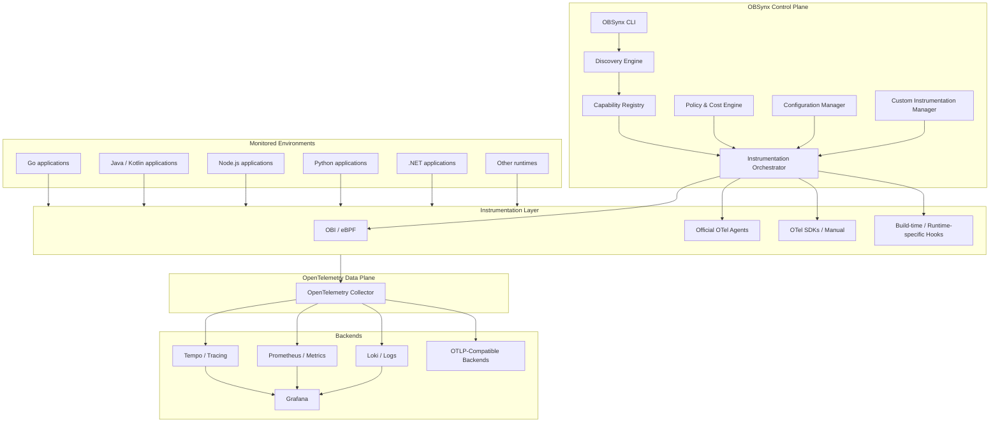

# OBSynx --- Technical Architecture & Action Plan

**Version:** 0.2\
**Date:** November 18, 2026\
**Status:** Architectural Proposal for Validation\
**Positioning:** Universal Observability & Instrumentation Platform\
**Tagline:** Discover. Instrument. Observe.

------------------------------------------------------------------------

## 1. Executive Summary

**OBSynx** is an observability discovery, automation, orchestration, and governance layer built on top of the OpenTelemetry ecosystem.

Its purpose is to simplify instrumentation across heterogeneous environments, reducing the manual effort required to discover applications, select instrumentation strategies, configure pipelines, and control telemetry volume.

OBSynx **does not intend to replace OpenTelemetry** nor reimplement SDKs, APIs, protocols, exporters, or the Collector. It reuses official and open-source components wherever possible, focusing custom development on key product differentiators:

1. Automatic discovery of applications, runtimes, frameworks, and dependencies.
2. Selection and orchestration of instrumentation strategies.
3. Unified configuration and lifecycle management.
4. Custom business instrumentation, where technically supported by the runtime.
5. Telemetry quality, security, and cost-control policies.
6. Diagnostics of capabilities, limitations, and operational impact.

The product is **runtime- and language-agnostic by architecture**. Go, Java/Kotlin, Node.js, Python, and .NET are validation environments, not platform limits.

### 1.1 Value Proposition

> Make OpenTelemetry observability simpler to discover, configure, operate, and optimize across multi-language and multi-runtime environments.

OBSynx reduces operational overhead and prevents unnecessary telemetry collection. It does not promise to eliminate all agents, eliminate all overhead, or instrument arbitrary functions across all runtimes without code modification.

------------------------------------------------------------------------

## 2. Problem Statement & Opportunity

OpenTelemetry provides robust APIs, SDKs, auto-instrumentations, protocols, and collectors. However, an engineering organization still faces complex operational questions:

- What applications exist across the fleet?
- What language, runtime, framework, and version does each application run?
- What instrumentation strategy is appropriate for each workload?
- Which auto-instrumentations are compatible?
- What configuration values and environment variables are required?
- How to keep agents, configurations, and collectors continuously up to date?
- How to prevent duplicate or conflicting instrumentation?
- How to govern cardinality, sampling, and data volumes?
- How to diagnose runtime limitations or instrumentation failures?
- How to instrument domain-specific business operations not captured by default HTTP/DB auto-instrumentations?

OBSynx acts as the automation and governance plane answering these operational questions.

### 2.1 What OBSynx Is Not

- Not a proprietary telemetry SDK.
- Not a replacement for the OpenTelemetry Collector.
- Not a telemetry storage or querying backend for traces, metrics, or logs.
- Not an unrealistic promise of universal zero-code for every arbitrary function.
- Not dependent on commercial vendor backends (Datadog, New Relic, Dynatrace).

------------------------------------------------------------------------

## 3. Architectural Principles

1. **OpenTelemetry native:** Native adoption of OTLP, semantic conventions, APIs, SDKs, and OTel components.
2. **Reuse before build:** Always evaluate mature official ecosystem solutions before building custom components.
3. **Universal by architecture:** The Core engine contains zero language-specific logic.
4. **Capability-driven:** Every adapter explicitly declares supported features, constraints, and prerequisites.
5. **Linux & container first:** Initial operational deployment targets Linux and containerized environments.
6. **Control plane / data plane separation:** Discovery and configuration management are isolated from the critical telemetry transport path.
7. **Low overhead:** Continuous overhead benchmarking coupled with active cost-reduction policies.
8. **Secure by default:** Minimal collection, attribute redaction, explicit permissions, and zero indiscriminate capture of sensitive PII.
9. **Observable by design:** OBSynx exposes operational logs, metrics, and health diagnostics for its own processes.
10. **Graceful degradation:** Unsupported capabilities are clearly messaged, providing supported alternatives without breaking telemetry.

------------------------------------------------------------------------

## 4. OpenTelemetry Ecosystem Integration

OBSynx orchestrates existing ecosystem components rather than rebuilding them:

| Component | Responsibility | Role in OBSynx |
| :--- | :--- | :--- |
| **OpenTelemetry APIs/SDKs** | Telemetry APIs and SDKs | Manual or assisted instrumentation when required |
| **OpenTelemetry Java Agent** | JVM auto-instrumentation | JVM Adapter foundation |
| **Official Language Hooks** | Library and framework auto-instrumentations | Per-runtime adapters |
| **OpenTelemetry eBPF (OBI)** | Kernel/network observability for supported runtimes | eBPF/Linux Adapter |
| **OpenTelemetry Collector** | Telemetry ingestion, processing, and export | Centralized telemetry pipeline |
| **OTLP** | Standard transport protocol | Seamless component integration |
| **Semantic Conventions** | Standardized attribute and metric naming | Data normalization and consistency |

Component availability, stability, compatibility, and maturity are evaluated per version and runtime prior to integration.

### 4.1 Instrumentation Strategies

OBSynx selects the optimal instrumentation strategy based on runtime, version, framework, environment, and observability goals:

| Strategy | Example | Application Code Modification | Limitations |
| :--- | :--- | :--- | :--- |
| **Auto Agent** | Java Agent | None | Instruments supported frameworks and libraries |
| **eBPF** | OBI / Beyla | None | Observes kernel/network protocols; unaware of domain business semantics |
| **SDK / API** | OTel SDK | Required | Requires explicit code changes |
| **Build-time / Compile-time** | AST rewriting during build | May require build pipeline changes | Language- and toolchain-dependent |
| **Plugin / Extension** | Agent extension | None in business code | Requires compatible extension points |
| **Runtime Specific** | V8 Proxy, CoreCLR Profiler | None | Requires specialized adapter |

**Important:** "Zero-code" means applications can be instrumented without modifying source code in supported scenarios. It does not imply the absence of configuration, environment variables, permissions, or minor resource overhead.

### 4.2 Automatic vs. Custom Business Instrumentation

**Automatic instrumentation** covers operations recognized by existing libraries (HTTP endpoints, database queries, message queues, and standard frameworks).

**Custom instrumentation** enables observability into custom business methods and domain operations that auto-instrumentation cannot detect.

Conceptual configuration example:

```yaml
service:
  name: payments-api

instrumentation:
  automatic: true

  methods:
    - class: com.company.PaymentService
      method: processPayment
      tracing: true

    - class: com.company.CustomerService
      method: calculateCustomerRisk
      tracing: true
```

> 📖 **Runtime Interception Deep Dive:** For technical specifications and visual sequence diagrams on how each runtime intercepts these methods (JVM Byte Buddy, Node.js V8 Proxy, Python sitecustomize, and Go eBPF/Proxy), see [runtime-function-interception.md](runtime-function-interception.md).

This configuration represents a **target capability**. OBSynx applies rules only when the target runtime adapter possesses a viable, safe in-memory interception mechanism.

When zero-code business interception is unsupported by the runtime, OBSynx explains the boundary and suggests supported alternatives (e.g., assisted SDK snippets or compile-time weaving).

------------------------------------------------------------------------

## 5. High-Level Architecture



### 5.1 Control Plane
Responsible for discovery, planning, configuration generation, and lifecycle management:
- **CLI:** Human operator and CI/CD automation entrypoint.
- **Discovery Engine:** Workload and runtime inventory inspection.
- **Capability Registry:** Catalog of runtime capabilities and constraints.
- **Policy Engine:** Security, redaction, sampling, and cost guardrails.
- **Instrumentation Orchestrator:** Strategy resolution and execution.
- **Configuration Manager:** Config validation, templating, and drift detection.
- **Custom Instrumentation Manager:** Manages in-memory business interception rules.

### 5.2 Data Plane
Responsible for live telemetry transport:
- In-memory agents, runtime hooks, and official auto-instrumentations.
- Central OpenTelemetry Collector.
- Standard OTLP receivers, processors, and exporters.
- Storage backends for metrics, traces, and logs.

OBSynx introduces zero proprietary protocols into the primary telemetry path.

------------------------------------------------------------------------

## 6. Adapter & Capability Model

Each adapter implements a shared interface and declares its technical capabilities explicitly. The core never assumes all runtimes offer identical capabilities.

### 6.1 Capability Schema Example

```yaml
adapter:
  id: opentelemetry-java
  runtime: jvm
  strategy: java-agent

  capabilities:
    automatic_http: true
    automatic_database: true
    automatic_messaging: true
    custom_method_tracing: conditional
    custom_method_arguments: restricted
    custom_return_values: restricted
    metrics: true
    traces: true
    logs: conditional

  requirements:
    - compatible_jvm
    - application_restart

  constraints:
    - "Only supported libraries and framework versions are instrumented"
    - "Custom method instrumentation requires a compatible extension"
```

### 6.2 Initial Validation Matrix

| Runtime | Target Strategy | Primary Objective |
| :--- | :--- | :--- |
| **JVM (Java/Kotlin)** | Byte Buddy Agent | Bytecode transformation and method interception |
| **Go** | eBPF Uprobes & Local Proxy | Symbol inspection and register probes |
| **Node.js** | V8 Proxy Trap | ESM/CommonJS function wrapping |
| **Python** | `sitecustomize.py` Hook | CPython bootstrap hooking and method decorators |
| **.NET** | CoreCLR Profiler + StartupHook | IL rewriting and startup hook injection |

------------------------------------------------------------------------

## 7. Discovery Engine

Identifies running workloads and gathers metadata required to recommend optimal instrumentation strategies:
- Running processes, containers, and services.
- Language runtime and exact version.
- Recognized frameworks and dependencies.
- Exposed ports and network protocols.
- Pre-existing instrumentation or running agents.
- Collector availability and network reachability.

------------------------------------------------------------------------

## 8. Instrumentation Orchestrator

Translates workload discoveries and policy rules into a concrete instrumentation plan:
1. Receives workload inventory from Discovery Engine.
2. Queries the Capability Registry.
3. Detects pre-existing instrumentation.
4. Evaluates compatibility and environmental prerequisites.
5. Selects the appropriate strategy.
6. Emits declarative configurations.
7. Generates human-readable and machine-actionable execution plans (`obsynx plan`).
8. Applies verified configurations (`obsynx apply`).
9. Provides safe rollback capabilities (`obsynx rollback`).

------------------------------------------------------------------------

## 9. Custom Business Instrumentation Engine

Allows engineering teams to observe domain-specific operations without manually writing OTel SDK code into business repositories:
- Zero-code method wrapping and register inspection.
- Native PII safety guards: automatic blocking of sensitive attributes (`password`, `token`, `secret`, `cpf`, `credit_card`).
- Cardinality limits: hard-capping at 25 methods per service and 5 attributes per method.
- Nanosecond latency tracking and atomic metric accumulation.

------------------------------------------------------------------------

## 10. Cost-Aware Instrumentation Engine

Cost control is a foundational pillar of OBSynx:
- Drops operational noise (e.g. `/health`, `/metrics`, `/ready` endpoints).
- Manages parent-based and ratio sampling.
- Hard limits on span attributes and event counts.
- Memory and network overhead tracking to prevent noisy neighbor degradation.

------------------------------------------------------------------------

## 11. Security and Privacy

- Zero payload sniffing by default.
- Strict PII redaction and attribute allowlists.
- Least privilege execution; unprivileged fallback wherever kernel probes are restricted.
- SHA-256 configuration checksum tracking to detect out-of-band configuration drift.

------------------------------------------------------------------------

## 12. CLI & Operating Experience

Primary binary: `obsynx`.

```bash
# Validate configurations and source code (AST)
obsynx config validate

# Inspect available runtime adapters
obsynx adapters list
obsynx adapters explain <runtime>

# Discover workloads and generate instrumentation plan
obsynx discover
obsynx plan

# Apply non-destructive instrumentation
obsynx apply
obsynx status
obsynx doctor

# Cleanly rollback applied artifacts
obsynx rollback
```

------------------------------------------------------------------------

## 13. Action Plan & Version Roadmap

- **Phase 1 (Benchmark & Research):** Completed. Baseline overhead and coverage validated in local lab.
- **Phase 2 (OBSynx Core):** Completed. Runtime-agnostic Go CLI, configuration engine, and capability registry.
- **Phase 3 (Discovery & Orchestration):** Completed. Process inspection, plan generation, and safe rollback.
- **Phase 4 (Custom Instrumentation):** Completed. Multi-runtime in-memory interception across JVM, Node.js, Python, Go, and .NET.
- **Phase 5 (Cost-Aware Policies):** Completed. Collector filtering, PII redaction, and cardinality enforcement.
- **Phase 6 (Production Readiness & GitOps):** Completed. Enterprise GitOps decoupling (ADR-004), Kubernetes ConfigMaps, and AWS Lambda serverless support.
