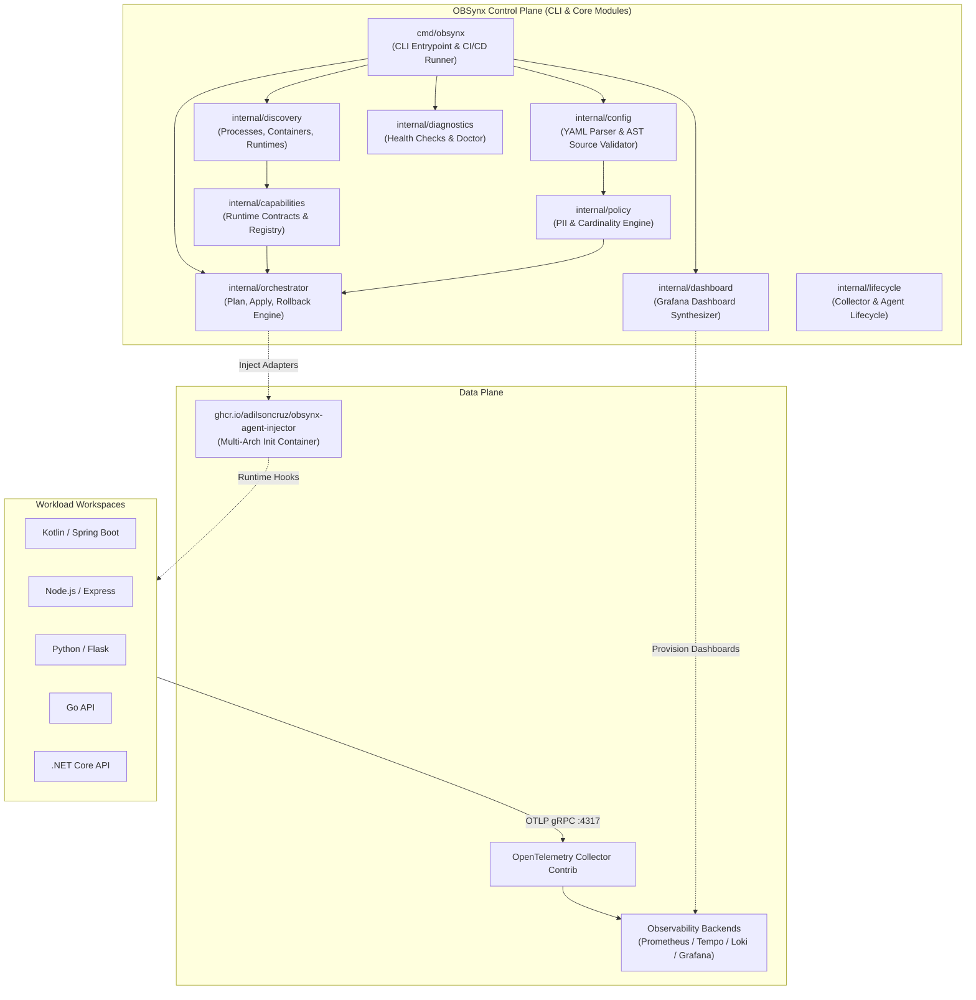

# OBSynx — Technical Architecture & Roadmap

**Version:** 0.1.0 (Current Release) / Roadmap v0.2.0  
**Date:** November 2026  
**Status:** Stable Implementation (`v0.1.0`) & Evolution Blueprint  
**Positioning:** Universal Observability & Instrumentation Platform  
**Tagline:** `zero-code observability config only.`  
**License:** Apache 2.0  

------------------------------------------------------------------------

## 1. Executive Summary

**OBSynx** is an observability discovery, automation, orchestration, and governance platform built on top of the OpenTelemetry ecosystem.

Its purpose is to eliminate manual telemetry plumbing across heterogeneous environments, providing:
1. **Automated Discovery:** Inspection of processes, containers, runtimes, frameworks, and existing instrumentation.
2. **Orchestration & Planning:** Selection of non-destructive instrumentation strategies with dry-run planning (`obsynx plan`).
3. **Shift-Left AST Validation:** Verification of telemetry rules against application source code in CI before deployment (`obsynx config validate`).
4. **Custom Business Telemetry:** Safe in-memory interception of business methods (`arg.*`, `res.*`, execution latency) without altering source code.
5. **Cost & Security Governance:** Native PII redaction, cardinality caps (25 methods/service, 5 attributes/method), and noise reduction.
6. **Unified Diagnostics & Self-Observability:** Automated health checks across host, container runtime, and OpenTelemetry Collector (`obsynx doctor`).

The platform is **runtime- and language-agnostic by architecture**. JVM (Java/Kotlin), Node.js, Python, Go, and .NET are supported reference runtimes.

### 1.1 Value Proposition

> Deliver production-grade OpenTelemetry metrics, traces, and dashboards across multi-language fleets using only declarative YAML configurations.

---

## 2. Problem Statement & Opportunity

OpenTelemetry provides standardized APIs, SDKs, auto-instrumentations, protocols, and collectors. However, engineering teams face significant operational hurdles:
- **Dispersed Inventories:** No unified visibility into runtimes, frameworks, and active telemetry across the fleet.
- **Manual SDK Code:** High friction in modifying microservice code to extract domain metrics and business parameters.
- **Risk of Drift & Cardinality Explosions:** Undisciplined metric label creation leading to massive observability vendor invoices.
- **Security & PII Exposure:** Accidental capture of passwords, tokens, API keys, and personal identifiers in traces.
- **Complex Upgrades:** Keeping language agents, sidecars, and collector pipelines synchronized and updated.

OBSynx acts as the automation and governance plane that solves these operational challenges.

### 2.1 What OBSynx Is Not
- **Not** a proprietary telemetry SDK (100% native OTLP and OpenTelemetry semantic conventions).
- **Not** a replacement for the OpenTelemetry Collector.
- **Not** a closed telemetry storage backend (works with Prometheus, Tempo, Loki, Grafana, and OTLP SaaS).
- **Not** an unrealistic promise of unconstrained zero-code for every arbitrary binary.

---

## 3. Architectural Principles & Quality Standards

1. **OpenTelemetry Native:** Native OTLP export, standard semantic conventions, and zero proprietary protocols on the data path.
2. **Shift-Left CI Quality Gates:** CLI acts as a pipeline validator with deterministic exit codes (`0` on success, `1` on error).
3. **Zero Business Code Changes:** Application repositories remain pristine; instrumentation is injected at runtime or deployment.
4. **Secure by Default:** Automatic blocking of PII keywords (`password`, `token`, `secret`, `creditcard`, `cpf`, `ssn`).
5. **Low Overhead:** In-memory atomic counters, nanosecond timing, and batched background OTLP dispatch every 4 seconds.
6. **Code Simplicity (Calisthenics & YAGNI):** Zero `else` statements across the Go codebase (guard clauses & early returns); test statement coverage ≥ 95%.
7. **Safe Rollback:** Complete reversal of injected overrides and configuration artifacts (`obsynx rollback`).

---

## 4. OpenTelemetry Ecosystem Integration

OBSynx orchestrates official and high-performance community components:

| Component | Responsibility in OBSynx | Implementation |
| :--- | :--- | :--- |
| **OpenTelemetry Collector Contrib** | Ingestion, batching, PII filtering, and export | Centralized pipeline (`deploy/collector/`) |
| **JVM Byte Buddy Agent** | Zero-code in-memory method interception | Java agent (`adapters/jvm/ObsynxJvmAgent.java`) |
| **Node.js V8 Proxy Trap** | Dynamic method interception and timing | Preload hook (`adapters/nodejs/obsynx-hook.js`) |
| **Python CPython Bootstrap** | Function wrapping and argument capture | Interpreter hook (`adapters/python/sitecustomize.py`) |
| **.NET CoreCLR Profiler** | Startup hook & bytecode injection | Runtime hook (`adapters/dotnet/ObsynxStartupHook.cs`) |
| **Go eBPF / Local Proxy** | Register probe and reverse-proxy metrics | Sidecar & eBPF observer (`adapters/ebpf/go-observer.py`) |
| **Grafana Synthesis** | Automated dashboard provisioning | Dashboard Engine (`internal/dashboard/`) |

---

## 5. Control Plane Architecture

The OBSynx Core is written in pure Go and structured into modular, decoupled packages:



### 5.1 Package Responsibilities

* **`cmd/obsynx`:** Unified CLI entrypoint supporting 12 subcommands, contextual help, and `--format text|json`.
* **`internal/discovery`:** Inspects OS process tables, container sockets, runtime signatures, and open ports.
* **`internal/capabilities`:** Enforces runtime capability constraints (e.g., custom method tracing, argument extraction).
* **`internal/config`:** Parses `obsynx.yaml` and executes AST analysis on application source files to verify method signatures before deployment.
* **`internal/policy`:** Evaluates security rules, detects PII keywords, and enforces cardinality thresholds.
* **`internal/orchestrator`:** Synthesizes non-destructive execution plans (`plan`), materializes overrides (`apply`), and restores pristine state (`rollback`).
* **`internal/dashboard`:** Translates declarative metric rules into production-ready Grafana JSON dashboards.
* **`internal/lifecycle`:** Manages agent injection environment variables, collector health, and process restarts.
* **`internal/diagnostics`:** Implements `obsynx doctor`, diagnosing host capabilities, collector connectivity, and configuration drift.

---

## 6. CLI Command Specification

The CLI is executable in developer terminals and headless CI/CD runners:

```bash
# Global syntax
obsynx <command> [arguments] [--format text|json] [--config obsynx.yaml]

# 1. Project Initialization
obsynx init

# 2. Shift-Left AST & Schema Validation (CI/CD Quality Gate)
obsynx config validate
obsynx config validate kotlin-spring-api
obsynx config validate examples/nodejs-api/obsynx.yaml

# 3. Adapter Capabilities & Metadata
obsynx adapters list
obsynx adapters explain jvm
obsynx adapters explain python

# 4. Workload Discovery & Planning
obsynx discover
obsynx plan
obsynx plan --format json

# 5. Non-Destructive Instrumentation Materialization
obsynx apply
obsynx status

# 6. Service-Level Instrumentation Inspection
obsynx instrument list
obsynx instrument explain payments-api

# 7. Grafana Dashboard Generation
obsynx dashboard generate --output-dir deploy/lab/grafana/dashboards --force

# 8. Reversal & Safe Cleanup
obsynx rollback

# 9. Health & Environment Diagnostics
obsynx doctor
obsynx doctor --format json
```

---

## 7. Delivery & Distribution Architecture

### 7.1 Multi-Platform Binary Releases
Every release tag builds cross-compiled static binaries with SHA-256 checksums:
- `darwin/arm64` (Apple Silicon macOS)
- `darwin/amd64` (Intel macOS)
- `linux/amd64` (x86_64 Linux servers & CI runners)
- `linux/arm64` (aarch64 Linux & AWS Graviton)
- `windows/amd64` (Windows x64)

### 7.2 Automated One-Line Installer
```bash
curl -fsSL https://raw.githubusercontent.com/adilsoncruz/obsynx/main/install.sh | bash
```
Features automatic OS/architecture detection, GitHub CLI (`gh`) auth support for private repositories, checksum verification, and `/usr/local/bin` installation.

### 7.3 Multi-Arch Agent Injector Container
Built and published via GitHub Actions to GitHub Container Registry:
- Image: `ghcr.io/adilsoncruz/obsynx-agent-injector:v0.1.0`
- Architectures: `linux/amd64`, `linux/arm64`
- Multi-stage build packaging Java Agent JAR, Node hook, Python hook, .NET hook, and eBPF observer into `/opt/obsynx/adapters/`.

---

## 8. Version Roadmap

### Phase 1: Foundation & Stable Core (`v0.1.0` — Delivered)
- [x] Runtime-agnostic Go CLI with 12 subcommands and dual-format output (`text`/`json`).
- [x] Zero `else` codebase enforcing Pragmatic Object Calisthenics and Guard Clauses.
- [x] Unit and integration test suite achieving **95.6% statement coverage**.
- [x] Multi-runtime interception hooks: JVM, Node.js, Python, Go, and .NET.
- [x] Shift-Left AST source code validator (`obsynx config validate`).
- [x] Local multi-service lab with automated synthetic traffic and Grafana dashboards.
- [x] Enterprise GitOps Telemetry Governance template with GitHub Actions workflow.
- [x] Multi-platform release automation and Docker Injector container.

### Phase 2: Kubernetes Operator & Serverless Automation (`v0.2.0` — Next)
- [ ] **OBSynx Kubernetes Mutating Admission Webhook Operator:**
  - Automatic pod annotation detection (`obsynx.io/inject: "true"`).
  - Transparent injection of the init container (`ghcr.io/adilsoncruz/obsynx-agent-injector`) and shared volume mount without modifying workload Helm charts.
- [ ] **AWS Lambda Layer Automated Publisher:**
  - Single-command packaging of runtime hooks into AWS Lambda Layers.
  - Automatic integration with AWS Serverless Application Model (SAM) and Terraform.
- [ ] **Kernel-Native eBPF Probes for Compiled Go Binaries:**
  - Replacement of Go sidecar proxy with native eBPF uprobes on ELF symbol tables.
- [ ] **Distributed Trace-to-Metrics Exemplar Links:**
  - Seamless jump from Prometheus metric spikes directly into Grafana Tempo trace IDs for intercepted business methods.
- [ ] **Dynamic Sampling & Cardinality Anomaly Watchdog:**
  - Runtime collector processor adjusting trace sampling ratios dynamically when error rates increase.
