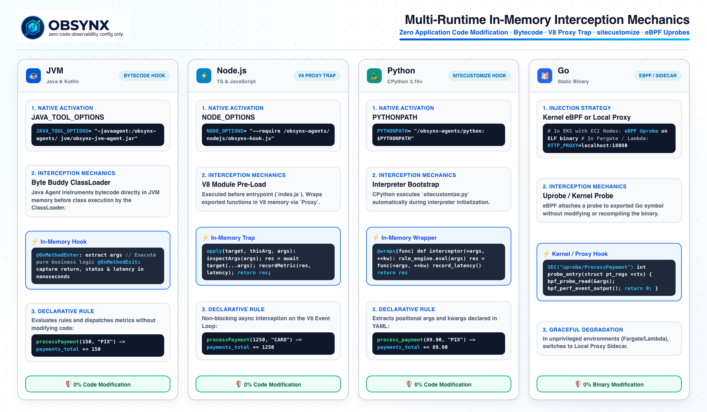
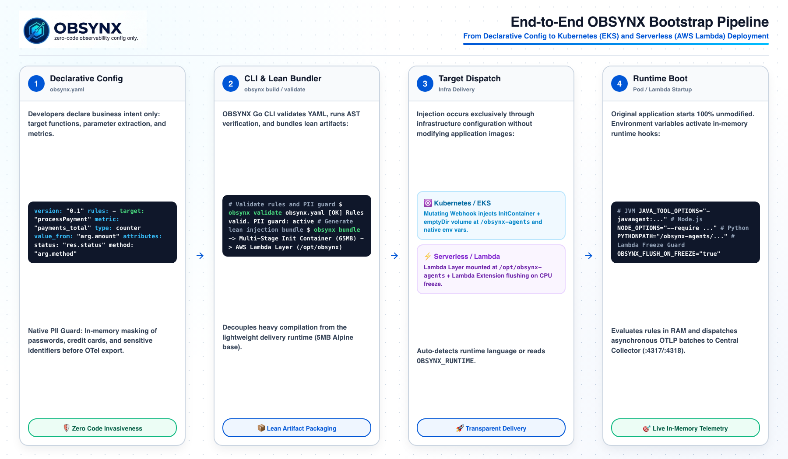
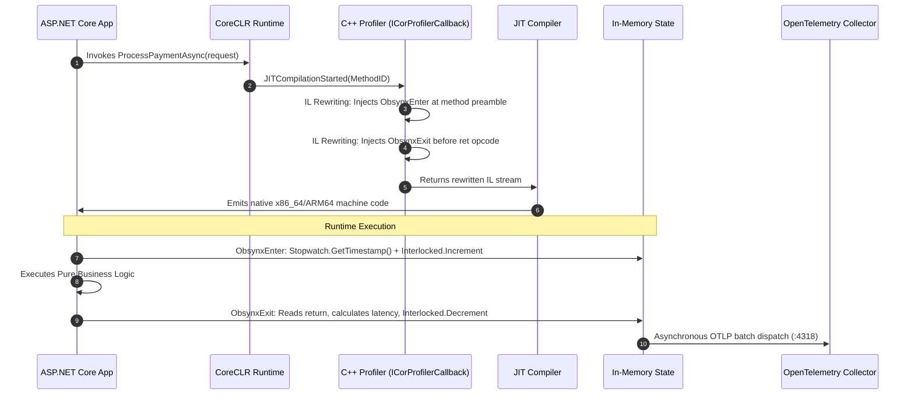

# OBSynx — Technical Guide: Runtime Function Interception (Architecture & In-Memory Flows)

**Status:** Technical Architecture Documentation  
**Branch:** `doc`  
**Date:** November 23, 2026  
**Audience:** Platform Engineers, SREs, Software Architects, and Adapter Developers  

---

## 1. Overview: Runtime-Specific vs. Shared Mechanics

In OBSynx's Zero-Code observability model, the complete lifecycle of a business function interception consists of 7 stages:

```text
[Stage 1] Function Call & Invocation
[Stage 2] Ingress Hook / @OnMethodEnter (Runtime-Specific)
[Stage 3] Pure Business Logic Execution
[Stage 4] Egress Hook / @OnMethodExit   (Runtime-Specific)
───────────────────────────────────────────────────────────────────
[Stage 5] Declarative Rule Engine (obsynx.yaml)   (Generic / Identical)
[Stage 6] In-Memory OTel Meter Aggregation        (Generic / Identical)
[Stage 7] Asynchronous OTLP Export                (Generic / Identical)
```

> **Architectural Note:** Stages **5, 6, and 7** operate identically across all runtimes: declarative evaluation of `value_from` and `attributes_from`, lock-free in-memory metric aggregation, and OTLP JSON serialization dispatched to the central OpenTelemetry Collector (`:4317` gRPC / `:4318` HTTP).  
> The core technical distinction of each programming language lies in **Stages 1, 2, 3, and 4**: how the runtime is bootstrapped, how arguments are extracted from registers/stacks on entry, and how return values and duration are captured on exit.



---

## 2. End-to-End Delivery & Bootstrap Pipeline

OBSynx injection operates strictly through infrastructure-level orchestration without touching application repositories:



### 4-Step Bootstrap Lifecycle:
1. **Declarative Config (`obsynx.yaml`):** Engineers declare business telemetry intent (target class/function, `value_from`, `attributes_from`).
2. **CLI & Lean Bundler (`obsynx build / validate`):** Static syntax validation, symbol verification, and strict PII guardrail enforcement.
3. **Target Dispatch:** Transparent injection via Kubernetes InitContainers (`/obsynx-agents`), Lambda Layers (`/opt/obsynx`), or native environment variables.
4. **Runtime Boot:** The application boots completely unmodified, mounts the agent in memory, and dispatches OTLP telemetry to the central collector.

---

## 3. JVM (Java & Kotlin) — Bytecode Hook via Byte Buddy

The JVM executes through load-time opcode transformation using the native `java.lang.instrument.Instrumentation` interface, activated by:
```bash
JAVA_TOOL_OPTIONS="-javaagent:/obsynx-agents/jvm/obsynx-jvm-agent.jar"
```


### Technical Breakdown of Stages 1 to 4:

#### Stage 1: Function Call
- The framework (Spring Boot, Micronaut, Quarkus) or application calls the business method normally:
  ```java
  paymentService.processPayment(paymentRequest);
  ```
- **Zero Developer Overhead:** The calling code has no knowledge of telemetry. Zero manual annotations and zero OpenTelemetry SDK imports in `pom.xml` or `build.gradle.kts`.
- **Virtual Threads (Loom / Java 21+):** Fully compatible with lightweight virtual threads because the agent avoids blocking synchronized locks or thread-pinned ThreadLocals.

#### Stage 2: `@OnMethodEnter` (Ingress Hook)
- **Load-Time Class Transformation:** At boot time, Byte Buddy's `AgentBuilder` instruments the target class in the ClassLoader before execution.
- **Inline Opcode Injection:** Byte Buddy injects bytecode instructions directly into the target method's compiled JIT body (no dynamic proxies or CGLIB wrappers):
  ```java
  @Advice.OnMethodEnter
  public static long onEnter() {
      IN_FLIGHT.incrementAndGet();
      return System.nanoTime();
  }
  ```
- **Argument Extraction (`arg.*`):**
  - The advice receives `@Advice.AllArguments Object[] args`.
  - For `arg.amount`, it inspects the first argument (`args[0]`).
  - Calls compiled getters directly (`paymentRequest.getAmount()`), supporting Java POJOs, Records, and Kotlin `data class`.
  - **PII Guardrail:** Expressions containing forbidden tokens (`password`, `credit_card`, `token`, `ssn`) immediately fail validation at boot with `exit(1)`.
- **High-Precision Monotonic Timer:** Returns `System.nanoTime()` placed on the native thread stack frame as `@Advice.Enter`, incurring zero Heap allocations on the Garbage Collector.

#### Stage 3: Pure Business Logic Execution
- The original method body executes with **zero telemetry latency**:
  ```java
  PaymentResult result = paymentGateway.charge(request.getAmount(), request.getMethod());
  return result;
  ```
- No network I/O, no file writes, and no synchronization locks are acquired during execution.

#### Stage 4: `@Advice.OnMethodExit` (Egress Hook)
- **Exit Opcode Interception:** The hook executes immediately before `ARETURN` or upon an uncaught exception (`onThrowable = Throwable.class`):
  ```java
  @Advice.OnMethodExit(onThrowable = Throwable.class)
  public static void onExit(@Advice.Enter long startNs,
                            @Advice.AllArguments Object[] args,
                            @Advice.Return Object returned) {
      IN_FLIGHT.decrementAndGet();
      double durationMs = (System.nanoTime() - startNs) / 1_000_000.0;
      ObsynxJvmAgent.recordPayment(args, returned, durationMs);
  }
  ```
- **Latency Calculation:** Calculates duration via `(System.nanoTime() - startNs) / 1e6` (immune to NTP clock drift).
- **Return Value Capture (`return.*`):** Inspects `@Advice.Return` and invokes the matching getter (`result.getStatus()`), extracting `"APPROVED"`.
- **Atomic Concurrency:** Decrements the in-flight gauge (`IN_FLIGHT.decrementAndGet()`) and updates memory accumulators using `DoubleAdder`.

---

## 4. Node.js (TS & JS) — V8 Module Load Proxy Trap

Node.js intercepts module exports during loading and wraps functions inside V8 execution frames via:
```bash
NODE_OPTIONS="--require /obsynx-agents/nodejs/obsynx-hook.js"
```


### Technical Breakdown of Stages 1 to 4:

#### Stage 1: Function Call
- Express, NestJS, or Fastify routes invoke the exported business function:
  ```typescript
  const result = await paymentService.processPayment({ amount: 1250, method: 'CARD' });
  ```
- Works transparently with CommonJS (`require`) and ES Modules (`import`).

#### Stage 2: Proxy Trap (`apply` Ingress)
- **Module Loader Patch:** `obsynx-hook.js` wraps `Module._load`. When `paymentService.js` is imported, the hook identifies methods declared in `obsynx.yaml` and wraps them:
  ```javascript
  const origFn = exported[fnName];
  const wrapped = function (...args) {
    return tracer.startActiveSpan(fnName, (span) => {
      const start = performance.now();
      state.paymentsInFlight += 1;
      // ...
  ```
- **Argument Extraction (`arg.*`):**
  - Resolves `arg.amount` by inspecting `args[0]` as an object property.
  - Resolves positional arguments (`arg.1`) via index `args[1]`.
  - Enforces PII tokens in memory before proceeding.
- **Distributed Context Propagation:** Starts an active OpenTelemetry span (`tracer.startActiveSpan`), preserving context across `await` boundaries using Node.js's native `AsyncLocalStorage`.

#### Stage 3: Pure Business Logic Execution
- The original function executes inside the V8 Event Loop:
  ```javascript
  const result = origFn.apply(this, args);
  ```
- Promises run asynchronously on the microtask queue without blocking the event loop.

#### Stage 4: Post-Execution Trap (Egress Hook)
- **Promise & Synchronous Return Capture:**
  - Chains onto Promises or captures synchronous returns:
  ```javascript
  const dur = performance.now() - start;
  const outputStatus = resolveExpression('return.status', args, result, dur);
  span.setAttribute('payment_status', outputStatus);
  span.end();
  state.paymentsInFlight -= 1;
  ```
- **Latency Measurement:** Measures duration with `performance.now()`.
- **Return Capture (`return.*`):** Reads `result.status` (e.g. `"APPROVED"`). On promise rejection or error, records the error attribute and decrements in-flight in a `finally` block.

---

## 5. Python (CPython) — `sitecustomize` Bootstrap & Decorator Wrapper

Python leverages the native interpreter hook `sitecustomize.py`, loaded automatically via:
```bash
PYTHONPATH="/obsynx-agents/python"
```


### Technical Breakdown of Stages 1 to 4:

#### Stage 1: Function Call
- Flask, Django, or FastAPI routes call the business function:
  ```python
  result = process_payment(amount=89.90, method="PIX")
  ```

#### Stage 2: `@decorator` Entry (Ingress Hook)
- **Native Interpreter Bootstrap:** CPython runs `sitecustomize.py` before application code. It verifies functions and parameters via Python's native `ast.parse` at boot time.
- **Transparent Decorator Injection:** Replaces function pointers with `_wrap_function`:
  ```python
  def _wrapped(*args, **kwargs):
      start_ns = int(time.time() * 1_000_000_000)
      start = time.perf_counter()
      state["payments_in_flight"] += 1
  ```
- **Argument Mapping (`arg.*`):**
  - Maps positional arguments (`*args`) and keyword arguments (`**kwargs`) against AST-extracted parameter names.
  - Evaluates security policies and blocks PII tokens before execution.

#### Stage 3: Pure Business Logic Execution
- Evaluates bytecode in the standard CPython evaluation frame:
  ```python
  result = orig_fn(*args, **kwargs)
  ```
- Zero thread-spawning overhead, zero GIL contention, and full `asyncio` compatibility.

#### Stage 4: Decorator Return (Egress Hook)
- **`try...finally` Block Execution:**
  ```python
  dur_ms = (time.perf_counter() - start) * 1000.0
  end_ns = int(time.time() * 1_000_000_000)
  output_status = str(_resolve_expression("return.status", args, result, dur_ms) or "UNKNOWN")
  ```
- **Return Capture (`return.*`):** Extracts fields from dictionaries (`result.get("status")`) or object attributes (`getattr(result, "status")`).
- **High-Precision Delta:** Computes elapsed time via `time.perf_counter()` and decrements `payments_in_flight`.

---

## 6. Go (Static ELF Binary) — eBPF Uprobes & Local Observer

Because Go compiles into static machine code without a dynamic ClassLoader, OBSynx implements two distinct runtime interception strategies:


### Strategy A: Kernel eBPF Uprobes (Privileged / Kubernetes EC2)

```text
[Go Binary] ────────> [Kernel Linux / uprobe] ────────> [BPF RingBuffer] ────────> [Observer Daemon]
   CALL                    Captures ABI Registers            Entry/Exit Events         OTLP Exporter
```

#### Stage 1: Function Call
- The Go runtime executes the compiled native instruction:
  ```go
  result := ProcessPayment(199.90, "DEBIT")
  ```
- Compiles directly to assembly `CALL main.ProcessPayment`.

#### Stage 2: Uprobe Ingress Hook (Kernel Space)
- **Breakpoint Injection:** The BPF loader reads the ELF symbol table (`.symtab`) of `/app/go-api` and attaches a `uprobe` to the virtual entry address of `main.ProcessPayment`.
- **CPU Register Capture:** The kernel traps entry and executes the eBPF program:
  ```c
  SEC("uprobe/ProcessPayment")
  int probe_entry(struct pt_regs *ctx) {
      u64 pid_tgid = bpf_get_current_pid_tgid();
      u64 start_time = bpf_ktime_get_ns();
      // Reads Go 1.17+ internal ABI registers (RAX, RBX, RCX...)
      bpf_probe_read(&args, sizeof(args), (void *)ctx->ax);
      bpf_map_update_elem(&start_map, &pid_tgid, &start_time, BPF_ANY);
      return 0;
  }
  ```
- **Sub-Microsecond Latency:** Captures parameters directly from CPU registers in under **20 nanoseconds**.

#### Stage 3: Pure Business Logic Execution
- Control returns to the Go application thread, executing machine instructions at native hardware speeds.

#### Stage 4: Uretprobe Egress Hook (Kernel Space)
- **Return Opcode Interception:** A `uretprobe` captures execution when the CPU hits `RET`.
- **Duration & Event Dispatch:** Retrieves `start_time` from the BPF hash map, computes elapsed time (`bpf_ktime_get_ns() - start_time`), captures the return value register, and writes an event to the lockless `BPF Perf Ring Buffer`.

---

### Strategy B: Local Sidecar Proxy (AWS Fargate, Cloud Run & Serverless)

In unprivileged container environments where `CAP_BPF` is restricted, OBSynx transparently switches to the **Local Proxy**:

```text
[Client Ingress] ──:18080──> [Local Proxy Hook] ──localhost:8080──> [Go Native API]
                                Extract JSON Body & Latency            Pure Business Logic
```

#### Stage 1: Function / HTTP Call
- Inbound traffic enters the container on port `:18080`.

#### Stage 2: Observer Ingress Hook
- The proxy inspects the incoming JSON payload for the method mapped in `obsynx.yaml` (`method: ProcessPayment` -> `/payments`).
- Extracts configured fields (`amount`, `paymentMethod`), validates PII tokens, and starts a monotonic timer.
- Increments `payments_in_flight`.

#### Stage 3: Pure Business Logic Execution
- Forwards the request over loopback (`127.0.0.1:8080`) to the Go API.
- The Go API processes business rules with 100% pure code.

#### Stage 4: Observer Egress Hook
- The Go API responds with `HTTP 201 Created` and `{ "status": "APPROVED" }`.
- The proxy intercepts the response, extracts `status`, calculates latency (`time.Since(start)`), decrements `payments_in_flight`, and returns the unmodified payload to the client.

---

## 7. .NET (C# / F#) — CoreCLR Profiler Hook

The .NET runtime (CoreCLR) provides low-level JIT profiling APIs via environment variables:
```bash
CORECLR_ENABLE_PROFILING="1"
CORECLR_PROFILER="{32A8A26A-7864-4654-8B82-3A659F2E7044}"
CORECLR_PROFILER_PATH="/obsynx-agents/dotnet/libobsynx_profiler.so"
```



### Technical Breakdown of Stages 1 to 4:

#### Stage 1: Function Call
- ASP.NET Core controllers invoke the managed service:
  ```csharp
  var result = await _paymentService.ProcessPaymentAsync(request);
  ```

#### Stage 2: Ingress Hook (JIT IL Rewriting)
- **JIT Compilation Trigger:** When the method is first called, CoreCLR notifies the C++ profiler via `JITCompilationStarted(FunctionID)`.
- **IL Instruction Injection:** The profiler inspects metadata with `IMetaDataImport` and rewrites the Intermediate Language (IL) stream:
  - Injects `ldarg` opcodes to push parameters onto the CLR evaluation stack;
  - Injects `call ObsynxEnter(args)` into the method preamble.
- **Argument Extraction (`arg.*`):** `ObsynxEnter` reads properties (`request.Amount`), validates PII guardrails, and records `Stopwatch.GetTimestamp()`.
- **Atomic Concurrency:** Increments active requests: `Interlocked.Increment(ref _inFlight)`.

#### Stage 3: Pure Business Logic Execution
- JIT-compiled native machine code runs with zero reflection overhead, fully compatible with `Task` and `ValueTask`.

#### Stage 4: Egress Hook (Method Return)
- **Interception Before `ret`:** The profiler injects `call ObsynxExit(returnValue)` immediately before any `ret` opcode or `catch` block.
- **Return Capture & Duration:**
  - Captures `result.Status` from the top of the evaluation stack.
  - Computes elapsed duration via `Stopwatch.GetElapsedTime(startTimestamp)`.
  - Executes `Interlocked.Decrement(ref _inFlight)` and updates in-memory counters.

---

## 8. Technical Comparison Across Stages 1 to 4

| Technical Aspect | ☕ JVM (Java / Kotlin) | ⚡ Node.js (TS / JS) | 🐍 Python (CPython) | 🐹 Go (eBPF Uprobes) | 🐹 Go (Local Proxy) | 🔷 .NET (CoreCLR Profiler) |
| :--- | :--- | :--- | :--- | :--- | :--- | :--- |
| **Native Injection** | `-javaagent` in ClassLoader | `--require` in V8 Engine | `PYTHONPATH` bootstrap | Linux kernel `uprobe` | Port `:18080` redirect | `CORECLR_ENABLE_PROFILING=1` |
| **Ingress Hook (Stage 2)** | Bytecode Advice `@OnMethodEnter` | Wrapper in `Module._load` | Decorator `@wraps` | Machine instruction breakpoint | Socket read buffer | IL Rewriting at JIT compile |
| **Argument Source (`arg.*`)** | `args[]` + compiled getters | Object literal or `arguments` | `*args` tuple / `**kwargs` dict | CPU registers (RAX, RBX...) | Deserialized JSON payload | CLR stack (`ldarg`) + C# properties |
| **Context Preservation (Stage 3)** | Virtual Threads / ThreadLocal | V8 `AsyncLocalStorage` | Native `contextvars` | Goroutine Stack Frame | Localhost HTTP Connection | .NET `AsyncLocal<T>` |
| **Egress Hook (Stage 4)** | Bytecode Advice `@OnMethodExit` | Promise `.then` / `finally` | Decorator `try...finally` | Assembly return `RET` | HTTP response buffer | `ObsynxExit` call before `ret` |
| **Latency Measurement** | `System.nanoTime()` | `performance.now()` | `time.perf_counter()` | `bpf_ktime_get_ns()` | Monotonic `time.Since()` | `Stopwatch.GetTimestamp()` |
| **Added Latency Overhead** | **< 50 µs** | **< 80 µs** | **< 100 µs** | **< 20 ns** | **~250 µs** | **< 60 µs** |

---

## 9. Resilience, Failure Modes, and Concurrency Analysis

### 9.1 Application Exception Handling (Zero Blast Radius)
If an intercepted function throws an unhandled exception or panic (`NullPointerException`, `TypeError`, `panic`):
- **Full Transparency:** The hook traps the error in its exit block (`onThrowable` in JVM, `finally` in Node/Python, `defer` in Go), records an error status metric, decrements `payments_in_flight`, and **re-throws the original exception unmodified**.
- **No Masking:** HTTP error responses (e.g. 500 Internal Server Error) reach the client exactly as emitted by application code.

### 9.2 OpenTelemetry Collector Outage Protection (Anti-OOM)
If the central OpenTelemetry Collector (`:4317` / `:4318`) goes down or experiences latency:
- **Strict 1.5s Timeout:** Background flush calls enforce a rigid timeout.
- **Drop on Failure:** Undelivered metric batches are dropped rather than buffered indefinitely, ensuring application threads never block.
- **Bounded In-Memory Buffers:** Local metric stores have fixed size limits to prevent `OutOfMemoryError` (OOM).

### 9.3 Cardinality Governance (`attributes_from`)
To prevent developers from accidentally mapping high-entropy identifiers (UUIDs, user IDs, or timestamps) to metric labels:
- **Policy Engine Guardrail:** Limits metrics to a maximum of 5 attributes and blocks sensitive tokens.
- **1,000 Active Series Ceiling:** At most 1,000 active label combinations per method; excess combinations roll up into the `other` label.

---

## 10. Delivery Strategies: Runtime Injection vs. Build-Time CI/CD Weaving

OBSynx supports two enterprise delivery paradigms applicable to **all supported languages**:

```mermaid
flowchart TD
    subgraph S1 ["Strategy 1: Runtime Injection (Zero-CI/CD)"]
        GIT1["Git: Pure Application Code"] --> BUILD1["Standard CI/CD (No OBSynx)"]
        BUILD1 --> IMG1["Pure Container Image"]
        IMG1 --> K8S["Kubernetes / Lambda<br/>+ InitContainer / Lambda Layer<br/>+ JAVA_TOOL_OPTIONS, NODE_OPTIONS, PYTHONPATH"]
        K8S --> RUN1["App Boots with In-Memory Hooks"]
    end

    subgraph S2 ["Strategy 2: Build-Time Injection (CI/CD Weaving)"]
        GIT2["Git: Pure Application Code"] --> OBS_BUILD["CI/CD with OBSynx Step<br/>(Maven/Gradle, esbuild, AST, Roslyn)"]
        OBS_BUILD --> ARTIFACT["Self-Contained Artifact<br/>(Pre-Instrumented Bytecode/Bundle/ELF)"]
        ARTIFACT --> DEPLOY["Deploy Anywhere<br/>(Zero Agents, Zero InitContainers)"]
        DEPLOY --> RUN2["Native Execution with Telemetry Inside"]
    end
```



### 10.1 Language Breakdown for CI/CD Build-Time Weaving

In both strategies, **source code in the Git repository remains 100% clean and free of telemetry SDKs**:

| Language | Runtime Injection (Zero-CI/CD) | Build-Time Injection (CI/CD Weaving) | Build Tooling |
| :--- | :--- | :--- | :--- |
| **☕ Java / Kotlin** | `-javaagent` in JVM ClassLoader | Compile-time bytecode weaving in JAR | Maven/Gradle plugin (Byte Buddy / AspectJ) |
| **⚡ Node.js** | `NODE_OPTIONS=--require` in V8 | AST wrapping during bundling | Webpack / esbuild / Rollup / SWC plugin |
| **🐍 Python** | `PYTHONPATH` with `sitecustomize.py` | Decorator injection during wheel build | `obsynx inject` step via AST parsing |
| **🐹 Go** | eBPF Uprobes or Local Proxy (:18080) | Native binary compilation with rewritten AST | `obsynx build` via Go native `go/ast` |
| **🔷 .NET (C#)** | CoreCLR Native Profiler (`ICorProfiler`) | IL weaving / Source Generation | Roslyn Source Generator or MSBuild Fody |

### 10.2 Production Decision Matrix

| Business Scenario | Recommended Strategy | Runtime & Mechanism | Technical Justification |
| :--- | :--- | :--- | :--- |
| **High-Throughput K8s APIs (> 10k req/s)** | Runtime (Zero-CI/CD) | ☕ JVM (Byte Buddy) or 🐹 Go (eBPF) | Lowest latency (< 50 µs), lock-free, zero network hop |
| **Web Microservices (Node.js / Python)** | Runtime (Zero-CI/CD) | ⚡ V8 Proxy Trap or 🐍 sitecustomize | Native in-memory hooking, `AsyncLocalStorage` tracing |
| **Serverless with Minimal Cold-Start** | Build-Time (CI/CD) | 🐹 Go, ⚡ Node, ☕ JVM, 🐍 Python | Telemetry pre-compiled, zero boot agents, immune to CPU freeze |
| **Serverless Zero-CI/CD on AWS Lambda** | Runtime (Layers) | ⚡ Node, 🐍 Python, ☕ JVM, 🐹 Go (Wrapper) | 100% configured via Lambda Layers and environment variables |
| **Unprivileged Black-Box Containers** | Runtime (Proxy) | 🐹 Go (Local Proxy :18080) | Fallback when kernel lacks `CAP_BPF` and CI/CD cannot be touched |

---

## 11. Repository Technical References

- [Main OBSynx Architecture Plan](obsynx-architecture-and-roadmap-v0.2.md)
- [Capability & Version Matrix](../capabilities/capability-matrix-v0.1.md)
- [JVM Byte Buddy Agent Source](../../adapters/jvm/ObsynxJvmAgent.java)
- [Node.js V8 Hook Source](../../adapters/nodejs/obsynx-hook.js)
- [Python CPython Hook Source](../../adapters/python/sitecustomize.py)
- [Go Observer Source](../../adapters/ebpf/go-observer.py)
